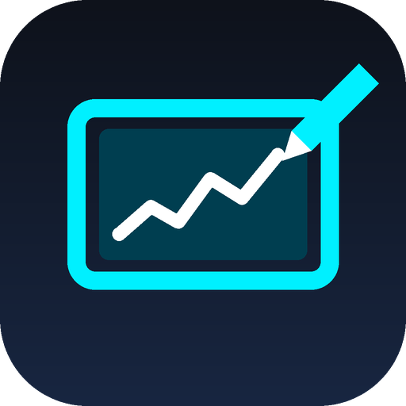

<p align="center"></p>

<h1 align="center">XDisplay</h1>

<p align="center">Use an Android phone or tablet as a low-latency second monitor for Windows, with pen pressure, tilt and touch.</p>

<p align="center">
  <a href="https://github.com/24f2006988/xdisplay-app/releases/latest">Download</a> ·
  <a href="#quick-start">Quick start</a> ·
  <a href="#troubleshooting">Troubleshooting</a> ·
  <a href="#building-from-source">Build from source</a>
</p>

---

XDisplay adds a real extra monitor to Windows and streams it to your Android device over a USB
cable or Wi-Fi. Windows sees the device as a normal display (extend, arrange, move windows onto
it), and your pen and fingers on the device control Windows, so drawing apps get real pressure and
tilt.

## Features

- **A real second monitor.** A virtual display driver gives Windows an extra screen sized to your
  device's panel (1:1 pixels when the resolution is known, 60 to 144 Hz).
- **USB.** Turn on USB debugging on the device and plug in the cable. The first time, the PC asks
  whether to allow the device; after that it reconnects by itself. (Version 1.0.0 also worked with
  USB debugging off through the UsbDk driver; that was removed in 1.0.1 because UsbDk could crash
  Windows when the cable was unplugged.)
- **Wi-Fi.** PCs on the network show up on the device automatically. Pair once with a 6-digit PIN;
  after that the connection is encrypted and reconnects by itself.
- **Pen and touch.** Pressure curves, tilt, hover, barrel button as right-click or eraser, palm
  rejection (pen-only mode), multi-touch, two-finger scroll, and pinch-to-zoom on the device.
- **Low latency.** GPU capture and hardware encoding (HEVC or H.264), hardware decoding on the
  device, adaptive bitrate, and local predicted ink under the pen.
- **Shortcut bar** with undo, redo, modifier keys and brush size for drawing apps.
- **Any Android 8.0+ phone or tablet** (64-bit and 32-bit ARM, x86_64), in landscape.

## Requirements

| | |
|---|---|
| PC | Windows 10 version 1903 or later, or Windows 11 (64-bit). A GPU with hardware video encoding is strongly recommended (any recent NVIDIA, AMD or Intel GPU). |
| Device | Android 8.0 or later, phone or tablet. A stylus is optional. |
| Wi-Fi mode | PC and device on the same network, with the network set to **Private** in Windows. 5 GHz Wi-Fi recommended. |

## Quick start

1. **Windows:** download `XDisplay-Setup-<version>.exe` from
   [Releases](https://github.com/24f2006988/xdisplay-app/releases/latest) and run it. It installs
   the app, the virtual display driver and the Wi-Fi firewall rules. Upgrading from 1.0.0, keep
   "Remove the UsbDk USB driver" ticked. Restart Windows if it asks you to.
2. **Android:** download `XDisplay-<version>.apk` on the device and open it (allow "install unknown
   apps" for your browser or file manager when asked). The installer also puts a copy in
   `C:\Program Files\XDisplay\android\`.
3. Start **XDisplay** on the PC (Start menu). It runs in the system tray; click the tray icon for
   the dashboard.
4. Connect:
   - **USB:** turn on **USB debugging** (Settings > Developer options), plug the device in, and
     allow the computer on the device if asked. The first time, choose **Yes** in the "allow new
     USB tablet?" prompt on the PC. If the device asks "Open XDisplay for this USB accessory?",
     tap **OK** (tick "always").
   - **Wi-Fi:** open XDisplay on the device, tap your PC under **PCs on this Wi-Fi** (or type the
     PC's IP address), and enter the PIN shown on the PC's dashboard. You only do this once.

The device's screen now appears in Windows **Settings > System > Display** as an extra monitor;
drag it to where it sits next to your main screen.

### Using it

- Tap **⚙ MENU** on the device for settings: refresh rate, bitrate (Auto is best), touch mode, pen
  pressure curve, barrel button, and the shortcut bar.
- **Pinch** with two fingers to zoom into part of the screen; double-tap with two fingers to reset.
- Swipe **back twice** to return to the connection screen.
- Only one device streams at a time. Connecting a second device takes over the screen, and the
  first one shows who took it.

## Troubleshooting

| Problem | Fix |
|---|---|
| The device does not list the PC | Same Wi-Fi on both, and Windows must treat the network as **Private** (Settings > Network & internet > Wi-Fi > your network). Run **Wi-Fi troubleshooter** from the Start menu. You can also type the PC's IPv4 address. |
| USB does nothing when plugged in | Restart Windows once after installing (the USB driver attaches at boot). Try another cable/port. Alternatively enable USB debugging on the device and install [Android platform tools](https://developer.android.com/tools/releases/platform-tools) (`winget install Google.PlatformTools`, or put `adb.exe` on PATH); XDisplay then uses adb automatically. |
| No second monitor appears, the main screen is mirrored instead | The virtual display driver is missing: run the installer again. |
| Wrong or lost PIN | Dashboard > **Wi-Fi & Pairing** > **New PIN**. |
| Picture is blurry or stutters on Wi-Fi | Use 5 GHz Wi-Fi close to the router, leave bitrate on **Auto**, or use USB. |
| A window is stuck on a screen you cannot see | Press `Win + P` and choose **PC screen only**, or start XDisplay and quit it from the tray. |
| Installing the APK fails with "conflicts with an existing package" | An older build signed with a different key is installed. Uninstall XDisplay from the device first. |

Logs are in `%LOCALAPPDATA%\XDisplay\logs` (Start menu > XDisplay > Log files). Please attach
them when [reporting a problem](https://github.com/24f2006988/xdisplay-app/issues).

## Security

USB connections are local and trusted. Network connections must pair with the PIN through a
password-authenticated key exchange (SPAKE2); after that every packet is encrypted and
authenticated (ChaCha20-Poly1305). The PIN is single-use and is replaced after five wrong
attempts. The Windows firewall rules only allow your local subnet on Private/Domain networks.

## Building from source

Prerequisites: [Rust](https://rustup.rs) (MSVC toolchain), Visual Studio Build Tools with the C++
workload, the Android SDK with NDK, JDK 17, `cargo install cargo-ndk`, and
[Inno Setup 6](https://jrsoftware.org/isinfo.php) for the installer.

```powershell
rustup target add aarch64-linux-android armv7-linux-androideabi x86_64-linux-android
.\scripts\build_release.ps1      # tests, APK, Windows host, installer -> dist\
```

Or piece by piece:

```powershell
cargo build --release -p xdisplay-host                 # Windows app: target\release\xdisplay-host.exe
cd client\native
cargo ndk -t arm64-v8a -t armeabi-v7a -t x86_64 -P 26 -o ..\app\src\main\jniLibs build --release
cd ..
.\gradlew.bat assembleDebug                             # or assembleRelease with a keystore
```

Release APK signing reads a properties file (`storeFile`, `storePassword`, `keyAlias`,
`keyPassword`) from `XDISPLAY_KEYSTORE_PROPERTIES` or `client\keystore.properties`; without one the
release APK is unsigned. Keys are never committed.

For development from a source checkout, `setup.bat` installs the driver and firewall rules and
`run_xdisplay.bat` / `run_xdisplay_wifi.bat` start the host. Release builds of the host are a
windowed app; `cargo run -p xdisplay-host` (debug) keeps a console for logs.

Run the tests with `cargo test --workspace` and `cargo test` in `client\native`.

See [ARCHITECTURE.md](ARCHITECTURE.md) for how it works.

## Project layout

| Path | Contents |
|---|---|
| `host/` | Windows app (Rust): capture, encoding, transport, input injection, dashboard |
| `common/` | Protocol, input formats and pairing crypto shared by both sides |
| `client/app/` | Android app (Kotlin) |
| `client/native/` | Android native engine (Rust): networking and hardware decoding |
| `driver/` | Display modes for the virtual display driver |
| `installer/` | Inno Setup script and redistributed driver packages |
| `scripts/` | Build, setup and troubleshooting scripts |

## License

XDisplay is free software: you can redistribute it and/or modify it under the terms of the
[GNU General Public License v3.0](LICENSE) or (at your option) any later version. Anyone may use,
study, share and modify it; distributed changes must stay under the same license.

Third-party components and their licenses are listed in
[THIRD_PARTY_NOTICES.md](THIRD_PARTY_NOTICES.md).
